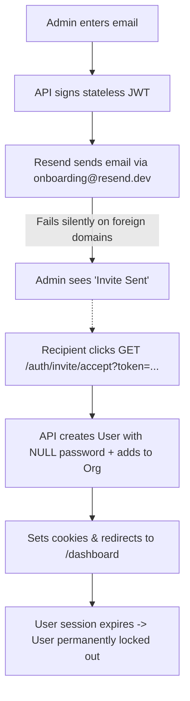
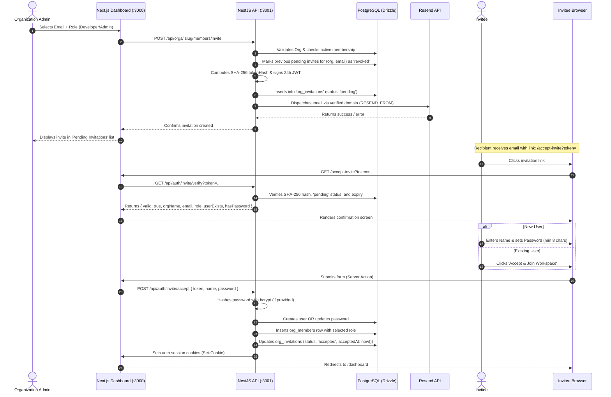

# Organization Invitation Feature — Architecture & Implementation Guide

## 1. Executive Summary

The Organization Invitation feature allows organization administrators in Orion to invite team members to collaborate in an organization with specific access roles (`developer` or `admin`).

This document details the redesigned invitation architecture, addresses the critical security loopholes and design flaws present in the initial implementation, and explains the step-by-step changes implemented across the database, backend NestJS API, and Next.js web application.

---

## 2. Legacy Implementation vs. Redesigned Architecture

### 2.1 Flaws & Vulnerabilities in the Legacy Implementation

| Flaw / Vulnerability | Legacy Behavior | Security & Operational Impact |
| :--- | :--- | :--- |
| **Resend Sandbox Restriction** | Hardcoded `from: 'onboarding@resend.dev'` | Resend strictly rejects sending emails to any address other than the verified account owner. Teammates never received invitations. |
| **Silent Error Swallowing** | Resend SDK v6 returns `{ data, error }`. Code ignored return value. | The API returned `{ message: 'Invite sent' }` even when Resend failed. Admins saw green success banners while emails were never sent. |
| **Stateless Token Replay** | No database record for invitations; only an in-flight JWT. | If an admin removed a user from an organization, the discharged member could reuse their original invite link (within 24h) to re-add themselves. |
| **Orphaned Accounts (Password Lockout)** | New users created with `passwordHash: null`. | Recipient logged in once via temporary cookies. When cookies expired, the user was permanently locked out (no password set, no reset flow). |
| **Email Scanner Side-Effects** | Accept route was an unauthenticated `GET /api/auth/invite/accept`. | Antivirus / mail security bots (Proofpoint, Microsoft Defender) prefetching links automatically consumed invites before the human opened them. |
| **Account Backdoor / Session Hijacking** | Any click on the link automatically issued session tokens. | If an invite link was intercepted or clicked in an existing browser session, cookies were overwritten or accounts assumed without password verification. |
| **No Revocation or Visibility** | No database persistence. | Admins could not view pending invitations or cancel invites sent to wrong email addresses. |

---

### 2.2 End-to-End Flow Comparison

#### Legacy Flow


#### Redesigned Flow


---

## 3. Implementation Steps

### Step 1: Database Schema & Shared Contracts

#### Database Schema: `org_invitations`
Defined in [`apps/api/src/db/schema/organizations.ts`](file:///c:/Users/Rudra/Desktop/GSFC/Projects/orion-db-prachi/apps/api/src/db/schema/organizations.ts):

```typescript
export const orgInviteStatusEnum = pgEnum('org_invite_status', [
  'pending',
  'accepted',
  'revoked',
  'expired',
]);

export const orgInvitations = pgTable(
  'org_invitations',
  {
    id: uuid().defaultRandom().primaryKey(),
    orgId: uuid('org_id')
      .notNull()
      .references(() => organizations.id, { onDelete: 'cascade' }),
    email: text('email').notNull(),
    role: orgRoleEnum('role').notNull().default('developer'),
    tokenHash: text('token_hash').notNull(),
    invitedBy: uuid('invited_by').references(() => users.id, {
      onDelete: 'set null',
    }),
    status: orgInviteStatusEnum('status').notNull().default('pending'),
    expiresAt: timestamp('expires_at').notNull(),
    createdAt: timestamp('created_at').notNull().defaultNow(),
    acceptedAt: timestamp('accepted_at'),
  },
  (table) => [
    index('org_invitations_org_id_idx').on(table.orgId),
    index('org_invitations_token_hash_idx').on(table.tokenHash),
    index('org_invitations_email_idx').on(table.email),
  ],
);
```

#### Shared Packages
- **`@orion/constants`**: Added `ORG_INVITE_STATUS` (`pending`, `accepted`, `revoked`, `expired`).
- **`@orion/types`**: Added `OrgInviteStatus`, `OrgInvitation`, and `OrgInvitationWithInviter` interfaces; updated `InviteMemberInput` with optional `role?: OrgRole`.

---

### Step 2: Backend API & Error Handling (`apps/api`)

#### Resend Error Detection & Configuration
In [`apps/api/src/members/invite.service.ts`](file:///c:/Users/Rudra/Desktop/GSFC/Projects/orion-db-prachi/apps/api/src/members/invite.service.ts):
- Respects `RESEND_FROM` or `EMAIL_FROM` environment variables.
- Detects `validation_error` when sending from `onboarding@resend.dev` to foreign email domains and throws a clear, actionable `BadRequestException`.
- Surfaces real Resend delivery errors rather than returning a false-positive success message.

#### SHA-256 Token Hashing & Anti-Replay
- The raw token is sent only in the email link: `${WEB_URL}/accept-invite?token=${token}`.
- The database stores only `sha256(token)`.
- When an invite is accepted, the database record is updated to `status = 'accepted'` with `acceptedAt = new Date()`.
- If an admin revokes an invitation, status is updated to `status = 'revoked'`.
- Expired or consumed tokens are immediately rejected.

#### Password Onboarding for New Users
When accepting via `POST /api/auth/invite/accept`:
```typescript
if (!user) {
  const passwordHash = options?.password
    ? await bcrypt.hash(options.password, 10)
    : null;

  const [newUser] = await this.drizzle.db
    .insert(users)
    .values({
      email: payload.email,
      name: options?.name ?? null,
      passwordHash,
    })
    .returning();
  user = newUser;
}
```
New users set their password directly during acceptance, ensuring they can log in via standard credentials in future sessions.

---

### Step 3: Frontend Dashboard & Acceptance Flow (`apps/web`)

#### 1. Role Selection & Pending Invites in Settings
In [`apps/web/src/features/members/members-client.tsx`](file:///c:/Users/Rudra/Desktop/GSFC/Projects/orion-db-prachi/apps/web/src/features/members/members-client.tsx):
- **Role Dropdown**: Admins can invite teammates as **Developer** or **Admin**.
- **Pending Invitations Table**: Displays all pending invites for the organization, the invited email, role badge, inviter details, and expiration date.
- **Revoke Button**: Instantly cancels a pending invitation via `MEMBERS_INTENT.REVOKE_INVITE`.

#### 2. Public `/accept-invite` Page
Located at [`apps/web/src/app/accept-invite/page.tsx`](file:///c:/Users/Rudra/Desktop/GSFC/Projects/orion-db-prachi/apps/web/src/app/accept-invite/page.tsx):
- Public route outside authentication guard.
- Pre-verifies the token using `GET /api/auth/invite/verify?token=...`.
- If valid, renders the custom card showing the organization name, role badge, and invited email.
- Adapts UI based on whether the account already exists:
  - **New user**: Prompts for Name and Password (minimum 8 characters).
  - **Existing user**: Single-click "Accept & Join Workspace" button.
- Submits securely via `POST /api/auth/invite/accept`, applies session cookies to the browser, and redirects to `/dashboard`.

---

## 4. API Endpoints Reference

| Method | Path | Auth Required | Description |
| :--- | :--- | :---: | :--- |
| `POST` | `/api/orgs/:slug/members/invite` | Yes (Admin) | Creates and emails an invitation `{ email, role? }`. |
| `GET` | `/api/orgs/:slug/members/invitations` | Yes (Admin) | Lists all active pending invitations for the organization. |
| `DELETE` | `/api/orgs/:slug/members/invitations/:invitationId` | Yes (Admin) | Revokes an active invitation. |
| `GET` | `/api/auth/invite/verify?token=...` | No | Pre-validates invitation token and checks if user exists. |
| `POST` | `/api/auth/invite/accept` | No | Accepts invite with `{ token, name?, password? }`, sets cookies. |
| `GET` | `/api/auth/invite/accept?token=...` | No | Backwards-compatible redirect endpoint. |

---

## 5. Verification & Testing

### Backend Unit Tests
Run via:
```powershell
pnpm --filter api test src/members/invite.service.spec.ts src/auth/auth.controller.spec.ts
```
- `sendInvite`: Validates org lookup, duplicate member rejection, DB persistence, and Resend error surfacing.
- `revokeInvitation`: Validates successful revocation and 404 on nonexistent invitations.
- `verifyInvite` & `acceptInvite`: Validates token hashing, replay prevention, role assignment, and password hashing.
- All 18 tests passing.

### Frontend Builds & Linting
- **ESLint**: Clean across `apps/web` (0 errors, 0 warnings on modified files).
- **Next.js Production Build**: `$ next build` generates static and dynamic routes including `/accept-invite`.

