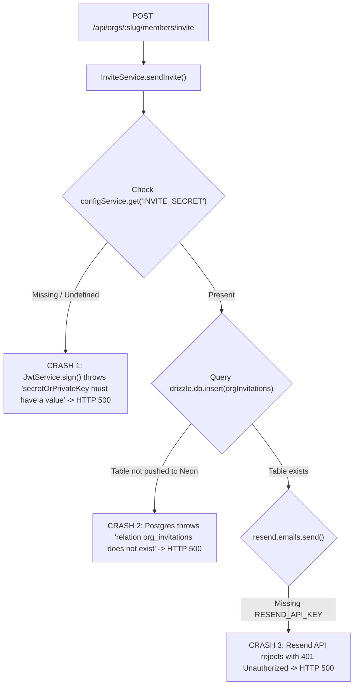

# Issue: HTTP 500 "Internal Server Error" on Member Invitation

**Issue Type:** `bug` / `configuration`  
**Components:** `apps/api` (`InviteService`), PostgreSQL Database  
**Status:** Diagnosed & Documented  

---

## 1. Problem Description

When an organization administrator attempts to invite a member from `/organizations/[slug]/settings/members`, submitting the invitation form results in a red banner displaying:

> **Internal server error**

The request fails with an HTTP 500 status code, and no invitation email is sent.

---

## 2. Environment

- **Frontend**: Next.js 16 (`apps/web` on `:3000`)
- **Backend**: NestJS 11 (`apps/api` on `:3001`)
- **Database**: Remote Neon PostgreSQL (`ep-winter-wave-...`)
- **ORM**: Drizzle ORM

---

## 3. Steps to Reproduce

1. Log in to the Orion dashboard as an organization administrator.
2. Navigate to `/organizations/<slug>/settings/members`.
3. In the "Invite a member" card, enter an email address (e.g. `colleague@example.com`).
4. Select a role (e.g., `Developer`).
5. Click **"Send invite"**.
6. **Result**: Red `Internal server error` appears above the form.

---

## 4. Root Cause Analysis

Three distinct configuration and schema synchronization gaps cause this failure in the API execution flow:



### 1. Missing `INVITE_SECRET` in `apps/api/.env` (Immediate Cause)
In [`apps/api/src/members/invite.service.ts`](file:///c:/Users/Rudra/Desktop/GSFC/Projects/orion-db-prachi/apps/api/src/members/invite.service.ts#L87-L92):
```typescript
const token = this.jwtService.sign(payload, {
  secret: this.configService.get('INVITE_SECRET'),
  expiresIn: INVITE_EXPIRES_IN,
});
```
Because `INVITE_SECRET` is not set in `apps/api/.env`, `configService.get('INVITE_SECRET')` returns `undefined`. When `jwtService.sign()` receives an undefined secret, it throws:
```text
Error: "secretOrPrivateKey must have a value"
```
Because this occurs inside an unhandled block in the controller/service, NestJS default exception filter maps it to `500 Internal server error`.

### 2. Unmigrated `org_invitations` Table on Remote Neon Database
The redesigned invitation flow persists invitation records to the `org_invitations` table:
```typescript
await this.drizzle.db.insert(orgInvitations).values({ ... });
```
Because `pnpm --filter api db:push` has not been executed against the active Neon database, the table does not exist. PostgreSQL aborts the transaction with:
```text
error: relation "org_invitations" does not exist
```

### 3. Missing `RESEND_API_KEY`
In `apps/api/.env`, `RESEND_API_KEY` is not defined. The service falls back to `'re_placeholder_dev_key'`, causing any outgoing email request to fail Resend API authentication.

---

## 5. Resolution Checklist

To resolve this issue completely in your environment, perform the following three steps:

### Step 1: Update `apps/api/.env`
Open `apps/api/.env` and add the missing environment variables:

```env
# Secret key used to sign and verify invitation tokens
INVITE_SECRET=orion_invite_super_secret_signing_key_2026

# Resend credentials for sending invitation emails
RESEND_API_KEY=re_your_actual_resend_api_key_here

# Optional: Verified sender email (default is onboarding@resend.dev)
# RESEND_FROM=notifications@yourdomain.com
```

### Step 2: Push Database Schema to Neon
Run the Drizzle schema sync command from the project root:

```powershell
pnpm --filter api db:push
```

*Expected output:*
```text
[✓] Applying migrations...
[✓] Table "org_invitations" created.
[✓] Indexes created.
```

### Step 3: Restart the API Server
Restart the API server so it reloads the new environment variables from `apps/api/.env`:

```powershell
pnpm run dev:api
```

---

## 6. Recommended Preventative Measure

Add startup environment variable validation in `apps/api/src/app.module.ts` using `Joi` or `Zod` with `@nestjs/config`:

```typescript
ConfigModule.forRoot({
  isGlobal: true,
  validationSchema: Joi.object({
    DATABASE_URL: Joi.string().required(),
    JWT_ACCESS_SECRET: Joi.string().required(),
    JWT_REFRESH_SECRET: Joi.string().required(),
    INVITE_SECRET: Joi.string().required(),
    RESEND_API_KEY: Joi.string().optional(),
  }),
})
```

This prevents the server from starting with missing secrets and provides instant console diagnostics at boot time instead of failing at runtime during user requests.
