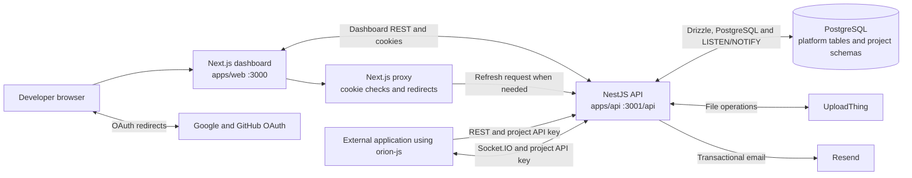

# Orion DB

Orion DB is a self-hosted backend platform for applications built on PostgreSQL. It combines a project dashboard, a NestJS API, project-scoped data APIs, authentication, realtime notifications, and object storage in one pnpm monorepo.

This document describes the architecture that exists in this repository. The platform is under active development; it does not currently include a global platform administrator console or a separate Supabase Edge Functions deployment.

## Contents

1. [System overview](#system-overview)
2. [Architecture and request flows](#architecture-and-request-flows)
3. [Components and responsibilities](#components-and-responsibilities)
4. [Authentication and authorization](#authentication-and-authorization)
5. [Data model and tenant isolation](#data-model-and-tenant-isolation)
6. [Repository layout](#repository-layout)
7. [Technology stack](#technology-stack)
8. [Configuration](#configuration)
9. [Local development](#local-development)
10. [Using the JavaScript SDK](#using-the-javascript-sdk)
11. [Operational notes and current limits](#operational-notes-and-current-limits)

## System overview

Orion has two application processes and three shared packages:

- `apps/web` is the Next.js dashboard used by developers to manage organizations, projects, schemas, SQL, auth settings, storage, and realtime.
- `apps/api` is the NestJS service. It serves dashboard endpoints, project REST endpoints, project auth, storage routes, and a Socket.IO gateway.
- `packages/orion-js` is the JavaScript and TypeScript client SDK for project APIs.
- `packages/types` and `packages/constants` hold shared TypeScript contracts and constants.

The API and dashboard are normally run locally on ports 3001 and 3000. A PostgreSQL database stores platform metadata and project data. Project data is separated by PostgreSQL schema within the same database; projects do not receive separate database instances.

## Architecture and request flows



The web proxy is Next.js request interception for dashboard routes. It checks access-token cookies for fast redirects and can ask the API to refresh a session. It is not a separately deployed edge-functions product.

### Dashboard request flow

1. The browser loads the Next.js dashboard.
2. `apps/web/src/proxy.ts` checks the platform access-token cookie on matched routes. Protected pages redirect to login when the token is missing or invalid. If a refresh cookie exists, the proxy asks the API to refresh it.
3. Dashboard server and client components call NestJS endpoints. Platform requests use the session cookies and organization membership checks.
4. NestJS reads or changes platform metadata and project schemas in PostgreSQL.

### Project data request flow

1. An external application initializes `orion-js` with a project URL and an API key.
2. The SDK sends requests to `/api/projects/:projectSlug/rest/:table` with a bearer project key.
3. `ProjectKeyGuard` verifies the signed key and identifies its project and role.
4. The project API validates the project slug, parses supported query filters, and runs parameterized database operations against that project's schema.

### Realtime request flow

1. The SDK opens a Socket.IO connection to the API's `/realtime` namespace and provides its project key during the handshake.
2. The gateway verifies the key and joins the socket to project-scoped rooms.
3. When realtime is enabled for a table, PostgreSQL triggers publish row events with `NOTIFY`.
4. The API listens on the corresponding channel and sends events to subscribed sockets.

### Storage request flow

1. A bucket and its access setting are stored in platform metadata tables.
2. The API validates the project and bucket, then exposes the UploadThing route for file transfer.
3. UploadThing stores file contents; Orion stores object metadata and the UploadThing key in PostgreSQL.
4. Public object URLs are stored for public buckets. Private objects use API-generated signed URLs.

## Components and responsibilities

### Web dashboard: `apps/web`

The Next.js App Router provides public landing, login, and registration routes, plus a protected dashboard route group. The dashboard includes organization and member management, project settings, a database table editor, SQL editor, project authentication settings and users, storage buckets and files, realtime controls, and generated API documentation.

Feature code is organized under `apps/web/src/features`; reusable UI components live under `apps/web/src/components`.

### API: `apps/api`

NestJS modules are registered in `apps/api/src/app.module.ts`. The global API prefix is `/api`.

| Module | Responsibility |
| --- | --- |
| `auth` | Developer registration and login, session tokens, OAuth callbacks, cookie handling, and refresh endpoints |
| `orgs` | Organization creation and lookup |
| `members` | Organization membership, roles, and invitations |
| `projects` | Project provisioning, schema creation, and project API key generation |
| `project-api` | Project REST reads and writes against user-created tables |
| `table-editor` | Project table and column inspection and schema changes |
| `sql-editor` | Dashboard SQL execution and query history |
| `project-auth` | End-user signup, sign-in, magic links, OAuth, and project auth settings |
| `realtime` | Socket.IO gateway and PostgreSQL notification subscriptions |
| `storage` | Bucket and object metadata, UploadThing handlers, and signed URLs |
| `db` | PostgreSQL connection, Drizzle client, and platform schema definitions |

The API bootstrap in `main.ts` configures cookies, CORS, WebSocket support, DTO validation, and the `/api` prefix.

### API surface

All HTTP routes are under `/api`. The main route groups are:

| Route group | Used by | Credential model |
| --- | --- | --- |
| `/auth/*` | Dashboard login, registration, OAuth, session refresh | Platform session cookies or refresh token |
| `/orgs/*` | Dashboard organizations, members, projects, table editor, SQL editor, storage management | Platform access-token cookie and organization membership |
| `/projects/:projectSlug/rest/:table` | External project data clients | Bearer project API key |
| `/projects/:projectSlug/auth/*` | End-user auth in applications built on Orion | Project auth endpoints and project-specific settings |
| `/projects/:projectSlug/storage/*` | External project storage clients | Bearer project API key; writes require service role |
| `/realtime` | Dashboard and external realtime clients | Socket.IO connection with project API key in handshake auth |

Project route prefixes and endpoint details can be confirmed in the controllers under `apps/api/src`.

### Shared packages

- `packages/constants` defines shared cookie names, role names, column types, filter operators, and realtime event names.
- `packages/types` defines shared API and domain TypeScript types.
- `packages/orion-js` exports `createClient`, `OrionClient`, the database query builder, auth helpers, realtime client, and storage client.

## Authentication and authorization

Orion has separate platform and project credentials.

### Platform sessions

Developers authenticate to the dashboard with email and password or configured Google/GitHub OAuth. The API issues access and refresh tokens in cookies. The web proxy performs an optimistic access-token check; API guards and membership checks enforce authorization on backend routes.

Organization roles are `admin` and `developer`. They apply within an organization. The current application has no global admin role or platform-wide admin panel.

### Project API keys

Each project has an `anon` key and a `service_role` key. Both are signed project tokens verified by `ProjectKeyGuard`.

- Use the anon key in client applications for the project operations allowed to that role.
- Use the service-role key only in trusted server code. Project data writes, uploads, and deletes require this role in the current API.
- Never expose the service-role key in a browser bundle, public repository, or client-side environment variable.

Project end-user authentication is implemented separately from dashboard sessions. It issues project auth tokens and manages users in the project's schema; it does not replace project API key authorization on the REST and storage routes.

## Data model and tenant isolation

Orion uses one PostgreSQL database connection for platform metadata and project data. Platform tables are in the `public` schema. When a project is created, the API provisions a schema with a generated name such as `proj_a1b2c3d4` and records that schema against the project.

Platform metadata includes users, organizations, organization memberships, projects and their keys, SQL query history, storage buckets, and storage objects. User-created tables and project-auth user data live in the project's schema.

Project API services resolve the schema from the verified project ID. Project identifiers and table names are validated before query execution; values are parameterized. This schema separation is logical isolation inside one database, not a separate PostgreSQL server or database per project.

## Repository layout

```text
orion-db/
├── apps/
│   ├── api/                    # NestJS API and database access
│   └── web/                    # Next.js dashboard
├── packages/
│   ├── constants/              # Shared enums and constants
│   ├── types/                  # Shared TypeScript types
│   └── orion-js/               # Client SDK
├── practical-9-evidence/       # Project evidence and test documentation
├── package.json                # Root development scripts
├── pnpm-workspace.yaml         # Workspace package discovery
└── pnpm-lock.yaml              # Locked dependency graph
```

Key source areas:

```text
apps/api/src/
├── auth/                       # Platform identity and sessions
├── db/schema/                  # Drizzle platform tables
├── members/                    # Organization membership
├── orgs/                       # Organization APIs
├── project-api/                # Project REST and key validation
├── project-auth/               # End-user project authentication
├── projects/                   # Project and schema provisioning
├── realtime/                   # Socket.IO and PostgreSQL notifications
├── sql-editor/                 # Dashboard SQL execution
├── storage/                    # Buckets, objects, UploadThing
└── table-editor/               # Table and column management

apps/web/src/
├── app/                        # App Router pages and layouts
├── components/                 # Shared UI
├── features/                   # Feature-specific UI and helpers
├── lib/                        # API clients and utilities
└── proxy.ts                    # Dashboard session redirects and refresh
```

## Technology stack

| Area | Technologies |
| --- | --- |
| Monorepo | pnpm workspaces |
| Dashboard | Next.js 16, React 19, TypeScript, Tailwind CSS 4 |
| API | NestJS 11, Node.js, TypeScript |
| Database | PostgreSQL, Neon-compatible connections, Drizzle ORM |
| Realtime | Socket.IO, PostgreSQL `LISTEN`/`NOTIFY` |
| Project SDK | TypeScript, `tsdown`, Socket.IO client, UploadThing client |
| Storage | UploadThing for file contents; PostgreSQL for bucket/object metadata |
| Email | Resend |
| OAuth | Google and GitHub providers |

## Configuration

Copy the example files before starting the applications. Use real secrets only in ignored local `.env` files or a deployment secret manager. Do not commit credentials.

### API environment: `apps/api/.env`

| Variable | Purpose |
| --- | --- |
| `PORT` | API listener port; local default is `3001` |
| `API_URL` | Public API base URL, including `/api`; local default is `http://localhost:3001/api` |
| `WEB_URL` | Allowed dashboard origin for CORS; local default is `http://localhost:3000` |
| `DATABASE_URL` | PostgreSQL connection string |
| `REALTIME_DATABASE_URL` | Optional direct, non-pooler PostgreSQL connection for realtime `LISTEN`/`NOTIFY` |
| `JWT_ACCESS_SECRET` | Signing secret for platform access tokens |
| `JWT_REFRESH_SECRET` | Signing secret for platform refresh tokens |
| `JWT_ACCESS_EXPIRES_IN` | Platform access-token lifetime |
| `JWT_REFRESH_EXPIRES_IN` | Platform refresh-token lifetime |
| `INVITE_SECRET` | Signing secret for organization invitations |
| `PROJECT_JWT_SECRET` | Signing and verification secret for project API keys and project auth tokens |
| `RESEND_API_KEY` | Resend credential for transactional email |
| `GOOGLE_CLIENT_ID`, `GOOGLE_CLIENT_SECRET` | Google OAuth application credentials |
| `GOOGLE_CALLBACK_URL` | Google OAuth callback URL |
| `GITHUB_CLIENT_ID`, `GITHUB_CLIENT_SECRET` | GitHub OAuth application credentials |
| `GITHUB_CALLBACK_URL` | GitHub OAuth callback URL |
| `UPLOADTHING_TOKEN` | UploadThing server credential |

### Web environment: `apps/web/.env.local`

| Variable | Purpose |
| --- | --- |
| `PORT` | Dashboard port; local default is `3000` |
| `API_URL` | Server-side API URL used by server rendering and proxy refresh |
| `NEXT_PUBLIC_API_URL` | API URL used by browser-side dashboard code |
| `NEXT_PUBLIC_WEB_URL` | Dashboard's public base URL |
| `JWT_ACCESS_SECRET` | Must match the API access-token secret for proxy verification |

The API CORS configuration currently allows the configured `WEB_URL` origin. Browser-based integrations hosted on a different origin need an explicit CORS configuration that allows that origin.

## Local development

### Requirements

- Node.js 20.9 or newer
- pnpm 10.9 or newer
- PostgreSQL, either local or hosted

### Install and configure

```bash
git clone https://github.com/Tirth678/orion-db.git
cd orion-db
pnpm install
cp apps/api/.env.example apps/api/.env
cp apps/web/.env.example apps/web/.env.local
```

Fill in the database URL and required secrets in `apps/api/.env`. Set the same `JWT_ACCESS_SECRET` in both API and web environment files. Configure OAuth and UploadThing credentials only when using those integrations.

### Start the applications

```bash
pnpm dev
```

Or run each process separately:

```bash
pnpm run dev:api
pnpm run dev:web
```

The dashboard is at `http://localhost:3000`; the API base is `http://localhost:3001/api`.

### Database schema

Drizzle schema definitions are in `apps/api/src/db/schema`. The repository provides `db:push`, `db:generate`, and `db:migrate` scripts in the API package. Review schema changes before applying them to a shared or production database.

```bash
pnpm --filter api db:push
pnpm --filter api db:generate
pnpm --filter api db:migrate
```

## Using the JavaScript SDK

The SDK expects the project's API URL, which has the form `/api/projects/:projectSlug`, and a project API key. In a client application, use the anon key:

```ts
import { createClient } from 'orion-js';

const orion = createClient(
  'http://localhost:3001/api/projects/<project-slug>',
  '<anon-key>',
);

const { data, error } = await orion
  .from('posts')
  .select('id, title')
  .eq('published', true)
  .limit(10);

const { data: files, error: storageError } = await orion.storage
  .from('avatars')
  .list();
```

Realtime subscriptions use `orion.realtime`; project end-user auth helpers are available under `orion.auth`. Storage uploads and deletes currently require the service-role key, so call them from trusted server code only. Do not put that key in browser code.

For a hosted external application, the API must be deployed or otherwise reachable from that application. `localhost` refers to the machine running the client and cannot reach a developer's separate machine over the public internet.

## Operational notes and current limits

- The dashboard is an organization/project management console. There is no platform-wide admin panel in the current implementation.
- The repository's edge-related code is the Next.js proxy for dashboard sessions. There is no `supabase/functions` directory or Supabase Edge Functions implementation in this codebase.
- Realtime notifications require PostgreSQL `LISTEN`/`NOTIFY`. Neon deployments should use a direct connection for the listener when the provider's pooled connection does not support it; set `REALTIME_DATABASE_URL` accordingly.
- Project anon and service-role keys are long-lived signed credentials. Protect the service-role key and rotate project keys if exposed.
- The storage access setting controls whether Orion stores a direct public URL or requires a signed URL. Currently, any valid project key can list bucket objects and request signed URLs, while uploads and deletes require the service-role key. Treat `private` as URL handling rather than a complete end-user authorization boundary until per-user bucket policies are implemented.
- The API CORS setting defaults to the dashboard origin. Update it deliberately when allowing additional browser origins.
- `pnpm run start` for the web app serves a production build. Run the build command before using it after source changes.
